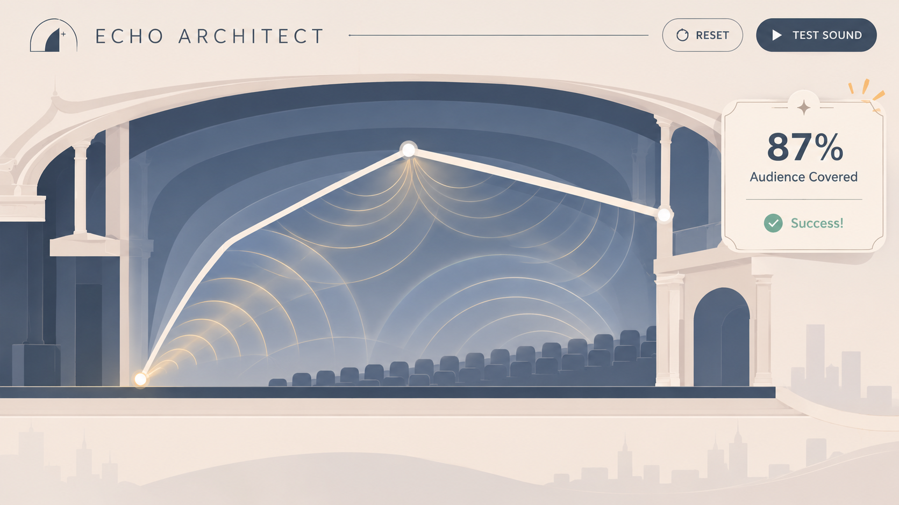

# PROCESS

## 1. Starting Idea

This project started as a small idea I had two years ago, when I wrote down lots of thoughts and ideas about musicals.
The project concept is a theatre acoustic design game inspired by the interaction style of Squiggle Drop. Players draw a roof in a theatre cross-section and test whether sound can reach the audience.

## 2. Design Decisions

The layout was inspired by architectural section drawings of theatres. These theatres feature uniquely designed roofs to help sound reach as many seats as possible. Thin, straight lines are used to represent sound waves, making the paths of sound reflection clearer.

## 3. Development Process

### Project setup

The project is a small static web app, with `index.html`, `style.css`, and `script.js` in the project root.

### HTML and CSS interface

The HTML contains the title, instructions, Canvas, controls, coverage display, warning, and result dialogs. The CSS provides the architectural styling, responsive layout, and button and modal states.

### Canvas theatre drawing

JavaScript draws the theatre in a 1000 by 560 Canvas coordinate system.
Separate functions draw the background, stage, source, floor, seats, and roof markers.

### Mouse-based roof drawing

Pointer Events record roof points while the player presses and drags from the start marker. Pointer coordinates are converted to Canvas coordinates, and drawing is constrained to the roof area.
After repeated testing, I found that the mouse-click detection around the **START** marker was not very responsive, so I expanded the clickable area.

### Sound reflection simulation

The sound test creates 20 rays at different upward angles. It checks each ray against the roof segments, finds the first intersection, and calculates a reflected direction. A ray that misses the roof continues without reflection.

### Audience seat detection

Each seat has a Canvas position and a coverage state. The scoring code checks whether any reflected ray passes within the seat detection radius. Each seat can only count once.

### Game result system

When a sound test completes, the game compares seat coverage with the 60% target and displays a success or failure modal with the percentage. A warning appears if the player tries to test before drawing a valid roof. Restart controls clear the roof, rays, and seat states.

## 4. Design and Code Changes

| Change | Reason | Evidence or result |
| --- | --- | --- |
| Changed the two-level audience seating to a single level. | The two-level layout blocked too much of the view, making some seats difficult to see. | The new layout makes the seats easier to see and helps players understand which seats are covered by sound. |
| Changed the drawing interaction from clicking to create connected line segments to dragging the mouse to draw a continuous, irregular line. | The original clicking method made it too easy to complete the challenge. A simple straight line could provide enough sound coverage to pass the level. | The dragging method allows players to create more varied roof shapes. It makes the challenge more difficult and encourages players to experiment with different designs. |
| Increased the mouse click detection area around the Start point. | During testing, the clickable area was too small. Players had to click very precisely to activate the Start point, which made the interaction frustrating. | After increasing the detection range in the code, players could activate the Start point more easily without needing to click directly on its centre. |
| Changed the original blue-and-white minimalist line style to a softer, warm pale-yellow colour scheme. | The original blue-and-white design looked a little cold and plain. I wanted to create a warmer and more welcoming visual atmosphere. | The new colour scheme makes the game look softer, more elegant and visually appealing. |

## 5. User Testing

Complete this section after a real participant has tried the game. Keep their
identity anonymous and omit identifying details.

- **Testing participant:** _Use an anonymous label, such as “Participant A”._
- **What the participant tried:** _Describe the tasks they attempted._
- **Where they hesitated:** _Record observed hesitation or uncertainty; do not
  infer it without evidence._
- **What I observed:** _Record actions and comments accurately._
- **Problems discovered:** _List problems found during the session._
- **Testing context:** _Add the date or development stage, device, and browser
  if relevant._

## 6. AI Tools and Assistance

- **AI tools used:** Chatgpt, VS Code
- **How each tool was used:** 
**Chatgpt:** Help me choose the right tools for different parts of the project. Translate. Make picture.
**VS Code:** Write the code.

## 7. Reflection

Replace the straight lines representing sound with multiple curved wave lines. Adjust their transparency as they reflect off surfaces, creating a softer, smoother and more dynamic visual effect.