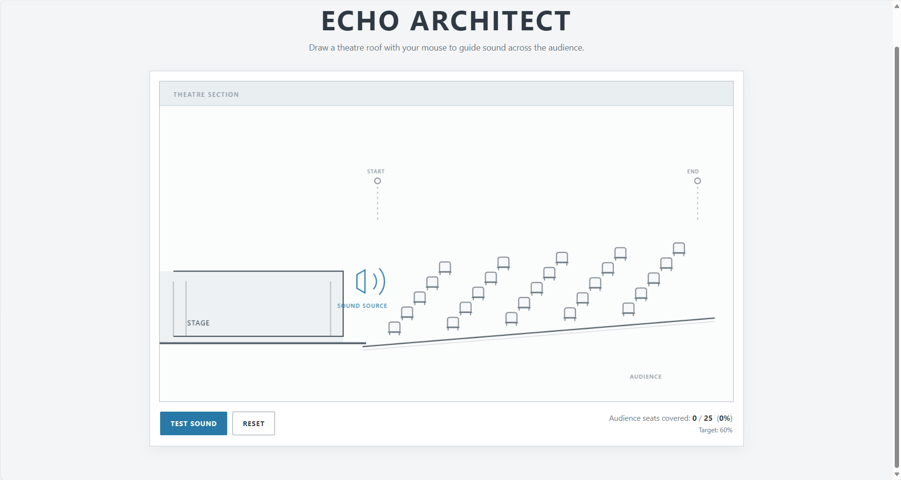
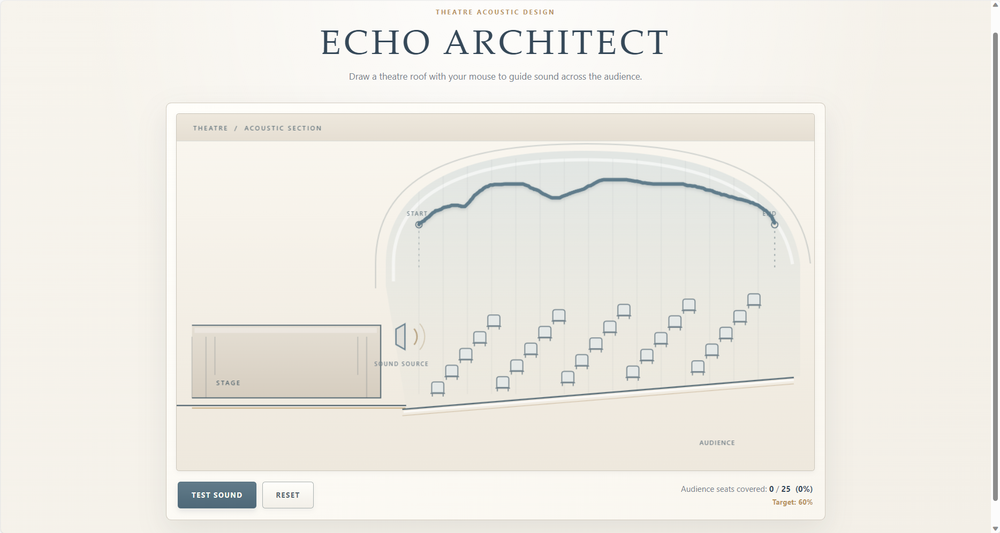
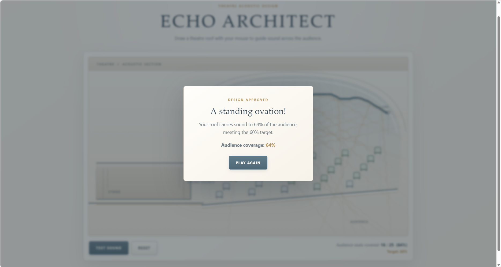
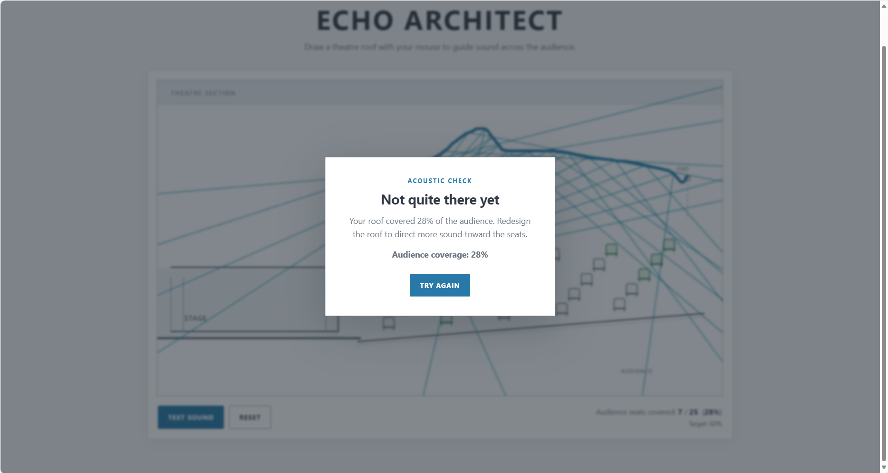

# ECHO ARCHITECT

## 1. Project Overview

Echo Architect is a small browser game about theatre acoustics. Players draw a roof over a theatre cross-section and test how sound rays reflect toward the audience. The aim is to experiment with the roof design and reach at least 60% of the audience seats.

## 2. Target Audience

Perhaps someone who shares my love of musical.

## 3. How to Play

1. Press and drag from the **START** marker to draw a roof toward the **END** marker.
2. Click **TEST SOUND**.
3. Observe which sound rays hit the roof and reflect into the auditorium.
4. Check the covered-seat count and coverage percentage. The success target is
   60%.
5. If coverage is below the target, click **RESET** and try a different roof.

The game warns you if you test without a valid roof. Roof editing and the test
button are disabled while a sound simulation is running.

## 4. Main Interaction

| User input | Program response | Visual feedback |
| --- | --- | --- |
| Draw a roof from the start marker | Records pointer positions inside the roof area | A blue roof line follows the pointer |
| Click **TEST SOUND** with a valid roof | Generates rays and calculates roof intersections and seat coverage | Cyan sound rays appear; covered seats turn green |
| Click **TEST SOUND** without a valid roof | Does not run the test and shows a warning | A short warning appears by the controls |
| Wait for the simulation to finish | Compares the coverage percentage with the 60% target | A success or failure modal displays the final result |
| Click **RESET**, **PLAY AGAIN**, or **TRY AGAIN** | Clears the roof, sound rays, and seat coverage | The theatre returns to its initial state |

## 5. Screenshots
### Main Game Interface

### Drawing Simulation

### Successful Result

### Failure Result

## 6. Technologies

| Technology | Purpose |
| --- | --- |
| HTML | Defines the game page, controls, coverage display, and result dialogs |
| CSS | Styles the interface and makes the layout responsive |
| JavaScript | Handles pointer input, scene drawing, sound-ray calculations, seat scoring, and game results |
| HTML Canvas 2D | Renders the theatre, roof, seats, and sound rays |

## 7. How to Run

1. Open the project folder in [Visual Studio Code](https://code.visualstudio.com/).
2. Confirm that `index.html`, `style.css`, and `script.js` are in the project
   folder.
3. Install the **Live Server** extension from the VS Code Extensions view if it is not already installed.
4. Open `index.html` and select **Go Live** in the status bar, or right-click the file and select **Open with Live Server**.
5. Play the game in the browser tab that opens.

## 8. Known Limitations

- The sound simulation is a simplified two-dimensional model, not a physically accurate acoustic simulation.
- The sound test uses 20 rays and a fixed 60% success target.
- **The victory condition is too easy to achieve. In fact, simply drawing a straight line is enough to reach the goal.**
